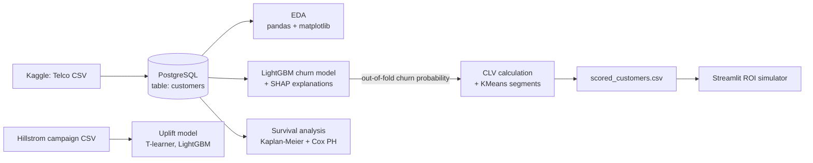
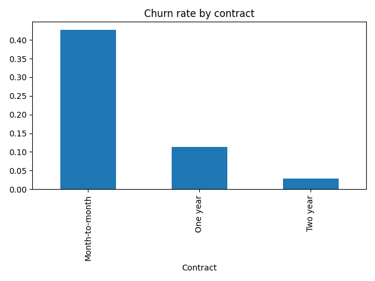
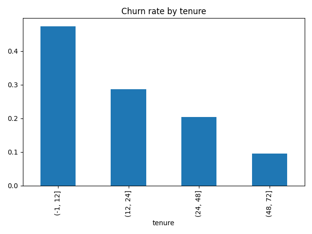
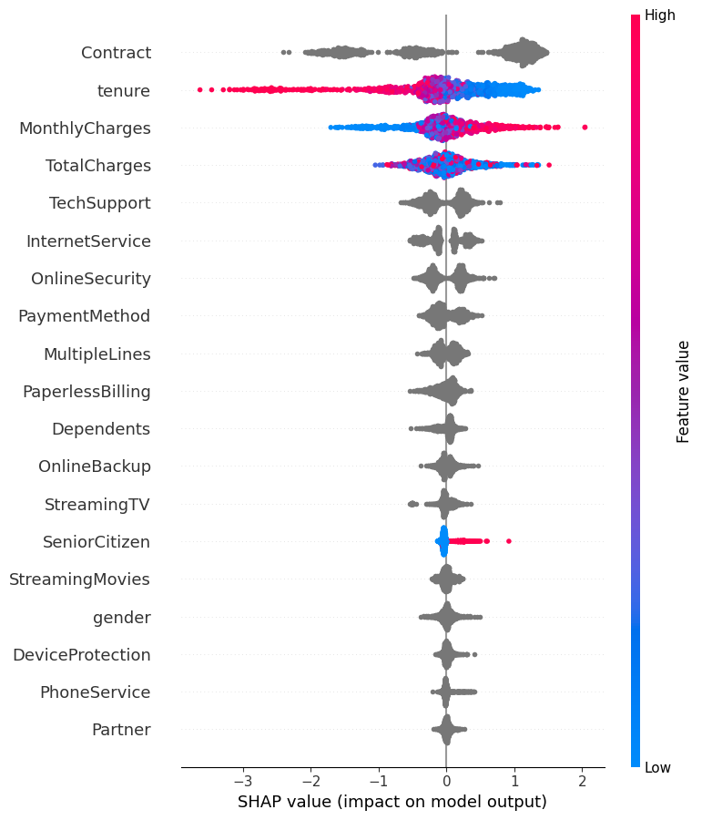
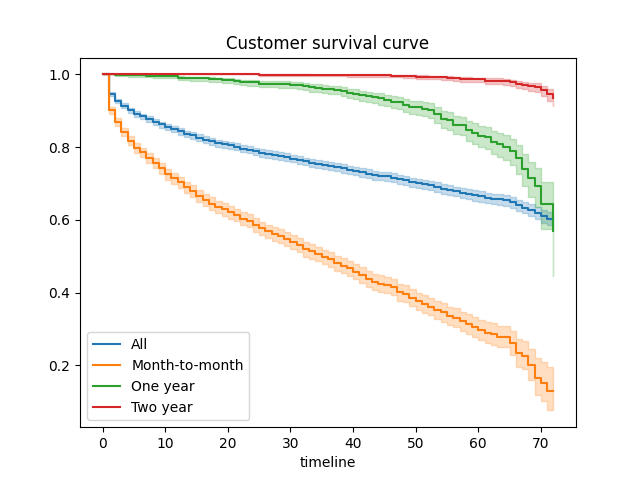

# DS-01: Customer Lifetime Value and Churn Intelligence System

Predicts which customers will leave, how long they will stay, and how much they are worth, then helps decide which retention offers are worth their cost.

**Live demo (Streamlit):** `PASTE_YOUR_STREAMLIT_URL_HERE`
**Demo video:** `PASTE_VIDEO_LINK_HERE`

---

## 1. Problem

Acquiring a new customer costs much more than keeping an existing one, but retention offers also cost money. A company needs to know:

1. Who is likely to churn?
2. How long will each customer probably stay?
3. Which customers respond to an offer (not just who is likely to leave)?
4. How valuable is each customer?
5. For a given discount, do the expected savings exceed the cost?

## 2. Dataset

- **IBM Telco Customer Churn** (Kaggle: `blastchar/telco-customer-churn`): 7,043 customers, 21 columns (tenure, contract type, internet service, monthly charges, churn flag, etc.). Overall churn rate: **26.5%**.
- **Hillstrom MineThatData E-Mail Campaign** (used only for uplift modeling, because Telco has no "offer given / not given" column). Treatment: "Mens E-Mail" vs control: "No E-Mail". Outcome: site visit.

## 3. Architecture



## 4. Methods and Results

### 4.1 Data loading and EDA
Raw data was cleaned (`TotalCharges` converted to numeric, `Churn` converted to 0/1), loaded into **PostgreSQL**, and read back with SQL for all later steps.

Key findings:
- Month-to-month contracts churn at about **43%**, one-year about **11%**, two-year about **3%**.
- Customers in their first 12 months churn at about **48%**, while customers with 48-72 months of tenure churn at about **10%**.




### 4.2 Churn classifier (LightGBM + SHAP)
- Stratified 80/20 train-test split, `LGBMClassifier(n_estimators=300, learning_rate=0.05)`.
- **Test ROC-AUC: 0.829**
- SHAP summary plot shows which features push a customer toward or away from churning.
- For downstream CLV, churn probabilities for all customers were produced with **5-fold out-of-fold prediction**, so no customer is scored by a model that saw them in training.



### 4.3 Survival analysis (Lifelines)
- Kaplan-Meier curves overall and by contract type.
- Cox Proportional Hazards model (concordance **0.83**, all p < 0.005):

| Feature | exp(coef) | Interpretation |
|---|---|---|
| Contract: Two year | 0.02 | About 98% lower churn hazard than month-to-month |
| Contract: One year | 0.15 | About 85% lower churn hazard than month-to-month |
| Internet: Fiber optic | 4.54 | About 4.5x higher churn hazard than DSL |
| Internet: No internet | 0.28 | Lower churn hazard than DSL |
| MonthlyCharges | 0.97 | Small negative effect after controlling for contract and service (correlated with fiber, so not read as "higher bill means less churn") |



### 4.4 Uplift modeling
A **T-learner** was built with LightGBM: one model on treated customers, one on control, and uplift = P(visit | treated) - P(visit | control). This is equivalent to CausalML's `BaseTClassifier`; it was implemented directly because CausalML did not install cleanly in the Python 3.13 Colab environment.

Actual uplift observed in each decile of predicted uplift (decile 9 = highest predicted uplift):

| Decile | 0 | 1 | 2 | 3 | 4 | 5 | 6 | 7 | 8 | 9 |
|---|---|---|---|---|---|---|---|---|---|---|
| Actual uplift | -0.241 | -0.072 | -0.016 | 0.021 | 0.052 | 0.076 | 0.122 | 0.164 | 0.245 | 0.414 |

Actual uplift rises steadily with predicted uplift, so the model ranks customers by responsiveness. The negative deciles ("sleeping dogs") are customers for whom the contact seems to backfire, so they should not be targeted.

### 4.5 Customer lifetime value and segmentation
`CLV = MonthlyCharges x 24 x (1 - churn_probability)` (expected revenue over 24 months). KMeans (k = 4) on standardized CLV, tenure and monthly charges:

| Segment | Name | Avg tenure | Avg monthly | Avg churn prob | Avg CLV |
|---|---|---|---|---|---|
| 0 | Loyal low-spenders | 54 mo | $31 | 0.04 | $700 |
| 1 | New low-spenders | 10 mo | $29 | 0.25 | $491 |
| 2 | Champions | 57 mo | $91 | 0.12 | $1,911 |
| 3 | High-value at-risk | 15 mo | $78 | 0.48 | $910 |

Segment 3 is the most important target for retention offers: high revenue and a high chance of leaving.

### 4.6 Streamlit ROI simulator
Interactive app (`app.py`). The user chooses a discount %, the assumed churn reduction caused by the offer, and how many of the riskiest customers to target. The app shows:
- **Offer cost** = sum of (monthly charge x discount x 12 months)
- **Expected savings** = sum of (CLV x churn probability x churn reduction)
- **Net ROI** = savings - cost

## 5. Repository structure

```
DS-01/
├── DS-01.ipynb            # full notebook (all steps)
├── app.py                 # Streamlit ROI simulator
├── requirements.txt       # dependencies for the Streamlit app
├── scored_customers.csv   # churn probability, CLV, segment per customer
├── data/
│   └── metrics.json       # model metrics
├── screenshots/           # charts used in this README
└── README.md
```

## 6. How to run

**Notebook (recommended: Google Colab, Python 3.10+):**
1. Upload `DS-01.ipynb` to Colab.
2. Add a Colab Secret `KAGGLE_API_TOKEN` (your own Kaggle API token) with notebook access ON.
3. Run cells from top to bottom. PostgreSQL is installed inside the Colab session by the notebook.

**Streamlit app locally:**
```bash
cd DS-01
pip install -r requirements.txt
streamlit run app.py
```

## 7. Limitations

- Telco data has no explicit usage-trend or complaint columns, so feature engineering used tenure, contract type, services and charges only.
- Uplift modeling uses a different dataset (Hillstrom) because Telco has no treatment/control flag. Uplift scores are therefore not applied to Telco customers.
- CLV is a simple 24-month expected revenue estimate (no discounting, no margin).
- ROI simulator inputs (churn reduction caused by an offer) are assumptions chosen by the user, not learned from data.
- No hyperparameter tuning was done; results are baseline LightGBM settings.

## 8. Next steps

- Tune LightGBM and calibrate probabilities.
- Replace the simple CLV formula with BG/NBD + Gamma-Gamma or a survival-based CLV.
- Run a real A/B test of retention offers on Telco-like data to learn offer effects.
- Apply the uplift model to targeting inside the ROI simulator.

## 9. Tech stack

Python, pandas, PostgreSQL (SQLAlchemy, psycopg2), LightGBM, SHAP, Lifelines, scikit-learn, Streamlit, Google Colab.
