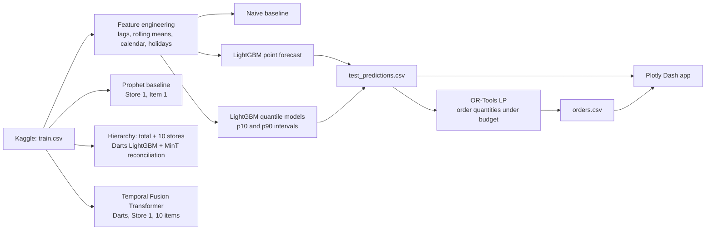

# DS-02: Nationwide Demand Forecasting and Inventory Optimization

Forecasts daily product demand across many stores, quantifies forecast uncertainty, makes store forecasts add up to the total, and calculates how much stock to order to limit stockouts and holding cost.

**Live demo (Dash):** `https://nexvia-demand-forecast.onrender.com`

---

## 1. Problem

Ordering too little causes lost sales; ordering too much causes waste and holding cost. A retailer needs:

1. Accurate demand forecasts per store and item.
2. Prediction intervals, not just a single number.
3. Forecasts that are consistent across the hierarchy (store forecasts must add up to the total).
4. A recommended order quantity that balances stockout and holding cost within a budget.

## 2. Dataset

**Store Item Demand Forecasting Challenge** (Kaggle: `demand-forecasting-kernels-only`): 10 stores x 50 items, daily sales from 2013 to 2017, 913,000 rows. Chosen from the listed dataset options because the M5 dataset is too large for a free Colab session.

## 3. Architecture



## 4. Methods and Results

### 4.1 Features
Lags (7, 14, 28 days), rolling means (7 and 28 days), day of week, month and a US-holiday flag. All lag and rolling features are at least 7 days old, so the model is a **7-day-ahead forecast**. Last 90 days of data were held out for testing.

### 4.2 Baselines and LightGBM (all 500 store-item series, 90-day test)

| Model | WAPE | RMSSE |
|---|---|---|
| Naive (sales 7 days earlier) | 0.166 | 0.872 |
| **LightGBM** | **0.113** | **0.589** |

LightGBM reduces WAPE by about 32% compared with the naive baseline.

### 4.3 Prediction intervals
Two LightGBM quantile models (alpha 0.1 and 0.9) give an 80% prediction interval. Empirical coverage on the test set: **78.5%** (target 80%).

### 4.4 Prophet baseline (single series: Store 1, Item 1)

| Model | WAPE (Store 1, Item 1) |
|---|---|
| Naive | 0.254 |
| LightGBM | 0.202 |
| Prophet | 0.185 |

On this one series Prophet is slightly better. Prophet forecasts the whole 90-day window at once, while LightGBM is a 7-day-ahead model, so the comparison is not perfectly like-for-like.

### 4.5 Hierarchical reconciliation (Darts)
The dataset has no region level, so the hierarchy is **total sales and 10 stores**. A Darts LightGBM model forecasts each node, then MinT reconciliation (`wls_val`) makes the forecasts coherent.

| | Before | After |
|---|---|---|
| Gap between sum of store forecasts and total forecast | 241.5 | 2.7e-12 (about 0) |
| Total WAPE | 0.1130 | 0.1126 |

### 4.6 Temporal Fusion Transformer
Implemented with Darts (PyTorch Lightning), trained on CPU for 15 epochs on a subset (Store 1, items 1-10) with quantile loss, forecasting 30 days ahead. **WAPE: 0.353.** This is worse than LightGBM. It is not a like-for-like comparison (30-day horizon vs 7-day horizon, small subset, few epochs, no tuning). With more compute, longer training and tuning it would likely improve.

### 4.7 Inventory optimization (OR-Tools)
For each item in Store 1, demand over the next 7 days is taken from the forecast in three scenarios: low (p10 sum, probability 0.25), mid (point forecast, 0.5) and high (p90 sum, 0.25). A linear program (GLOP) chooses order quantities that minimize expected holding and stockout cost, subject to a total budget.

Assumptions (illustrative, should be replaced with real business costs): unit cost 10, holding cost 1 per unit, stockout cost 4 per unit, budget = 85% of the cost of ordering the high scenario for every item.

Result: total spend 187,160 against a budget of 187,171. The budget is binding, so order quantities sit close to the mid forecast.

### 4.8 Dash app
Interactive app (`app.py`): headline metrics (WAPE, RMSSE, interval coverage), store and item dropdowns, a chart of actual vs forecast with the 80% interval, and a table of recommended order quantities.

## 5. Repository structure

```
DS-02/
├── DS-02.ipynb          # full notebook
├── app.py               # Plotly Dash app
├── requirements.txt     # dependencies for the Dash app
├── outputs/
│   ├── metrics.json
│   ├── prophet_metrics.json
│   ├── reconcile_metrics.json
│   ├── tft_metrics.json
│   ├── test_predictions.csv
│   └── orders.csv
└── README.md
```

## 6. How to run

**Notebook (Google Colab):**
1. Upload `DS-02.ipynb`.
2. Add a Colab Secret `KAGGLE_API_TOKEN` with notebook access ON, and accept the competition rules on Kaggle.
3. Run the cells from top to bottom. If Darts reports a missing PyTorch module, run `pip install "u8darts[torch]" lightning` and restart the session.

**Dash app locally:**
```bash
cd DS-02
pip install -r requirements.txt
python app.py
```
Then open http://127.0.0.1:8050.

## 7. Limitations

- The dataset has **no price or promotion columns**, so those features requested in the project brief could not be built. Features are lags, rolling means, calendar and holidays only.
- The forecast is **7 days ahead** because all lag features are at least 7 days old.
- The hierarchy is total and store only (no region level in this dataset).
- TFT was trained only on a small subset, on CPU, without tuning, so it is not directly comparable with LightGBM.
- Prophet was evaluated on one series only.
- Optimization costs, budget and scenario probabilities are assumptions, not real business data.
- The order optimization is computed for Store 1 only.

## 8. Next steps

- Use a dataset with price and promotion (for example M5) and add those features.
- Tune LightGBM and train TFT longer on a GPU.
- Extend reconciliation to more hierarchy levels (region, category).
- Optimize orders for all stores with real cost and lead-time data.

## 9. Tech stack

Python, pandas, LightGBM, Prophet, Darts (including TFT and MinT reconciliation), OR-Tools, Plotly Dash, Google Colab.
